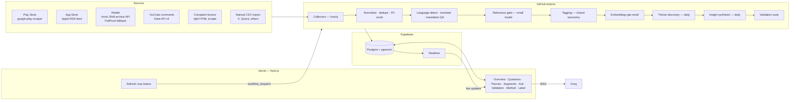

# Part 1 — AI Discovery Engine: Architecture

> v0.2 · 2026-11-22 · decisions from the planning chat are recorded in §12. Open items are marked **[OPEN]**.

## 1. Goal

Turn public user conversations about Blinkit into **validated, cited insights** that answer the 8 research questions in the brief:

1. Why do users repeatedly buy from the same categories?
2. What prevents users from exploring new categories?
3. How do users discover products today?
4. What role do habits play in shopping behaviour?
5. What information do users need before trying a new category?
6. What frustrations emerge repeatedly?
7. Which user segments are more likely to experiment?
8. What unmet needs emerge consistently?

The engine has to show four things: **how data is gathered → how themes are found → how insights are generated → how quality was validated.**

Differentiator: most reference projects stopped at "tag with an LLM + chatbot". Here **validation is a product feature**: measured tagging accuracy, quote-grounding checks, stability tests, cross-source triangulation, translation QA. Every insight carries prevalence, source spread and a confidence grade.

## 2. Stack (free tiers only)

| Layer | Choice | Notes |
|---|---|---|
| Collection + processing | Python 3.12 in **GitHub Actions** | Free for public repos, no serverless timeouts |
| LLM | **Groq only** — small model for filtering, larger model for tagging, translation and synthesis, a *different* Groq model family as the judge | Model choice depends on your account's limits page |
| Embeddings | **gte-small** (384-dim), built into Supabase | English-only, so we embed the English text (translated where needed). Setup comes later |
| Database + vector search | **Supabase** Postgres + pgvector + full-text search + Realtime | ~20k items is well under the 500 MB free limit |
| Frontend + API | **Next.js on Vercel** (Hobby) | Keys stay server-side in route handlers |

## 3. System diagram



## 4. Data sources (live-tested 2026-11-22)

| Source | Method | Key | Test result | Notes |
|---|---|---|---|---|
| Play Store | `google-play-scraper` · `com.grofers.customerapp` | none | ✅ 200 reviews, newest 2026-11-21 | Unofficial library; main volume source |
| App Store | Apple RSS JSON · id `960335206` · `in` | none | ✅ 50/page | Only the latest ~500 are available, so hourly runs build up history |
| Reddit | **Arctic Shift** API: posts by subreddit + query, comments by thread, comment-body search in small date windows | none | ✅ 95 Blinkit posts in r/bangalore (last 12 m), comments per thread work. Comment-body search times out on wide ranges, so we query in small windows | Third-party archive. Reddit plans to close its public API in March 2027, which could affect the archive's freshness. Data we've already stored stays |
| Reddit fallback | **PullPush** API | none | ⚠️ HTTP 429 (rate-limited) today | Use only for Reddit-wide search, with backoff |
| Reddit official | Data API | approval-gated | ❌ public JSON 403, RSS 404 (RSS ended 2026-11-13) | Not used |
| YouTube | Data API v3: search Blinkit review/haul/comparison videos → `commentThreads` | free Google key | pending key | Comments on haul and review videos show how people discover products socially |
| Complaint forums | consumercomplaints.in and similar, polite HTML scrape (robots.txt, low rate) | none | ✅ site reachable | Mostly ops complaints; the relevance gate will filter them |
| X, Quora, Instagram | **Manual CSV import** | — | X free API is write-only; scrapers are unreliable; Bluesky search 403 | You paste curated posts into a CSV and they go through the same pipeline |
| Trustpilot, MouthShut | — | — | Trustpilot 403 | Skipped unless you want manual import |

Subreddits: r/bangalore, r/mumbai, r/delhi, r/gurgaon, r/noida, r/pune, r/hyderabad, r/chennai, r/kolkata, r/india, r/indiasocial, r/IndianFood, r/indianpets, r/IndianSkincareAddicts, r/IndianBeautyDeals, r/ahmedabad. **[OPEN] add or remove any.**
Query terms: `blinkit`, `grofers`, `quick commerce`, `10 minute delivery`.

All collectors do idempotent upserts keyed on `(source, source_id)`. Window: **last 12 months** (rolling).

## 5. Processing pipeline

1. **Normalize** → `source, source_id, url, text, rating, posted_at, lang, author_hash, meta`.
2. **Dedupe** → exact hash + near-duplicate (MinHash). One-word reviews ("good") are counted but not analysed.
3. **PII scrub** → phones, emails, order IDs removed; usernames hashed and never shown.
4. **Language + translation** → detect Hindi / Hinglish → translate with the larger Groq model, keep the original → **translation QA** (§6 V7). Low-confidence translations are excluded from analysis instead of guessed.
5. **Relevance gate (small model)** → tags each item `discovery-relevant` or `ops-only` (delivery, rider, refund). Nothing is deleted; the ratio is reported as a finding.
6. **Tagging (larger model, JSON mode, versioned prompt, ~10 items per call)**. Taxonomy approved 2026-11-22:
   - `sentiment`
   - `categories_mentioned[]`: staples, fruits & veg, dairy, snacks, beverages, household, personal care, beauty, baby, pet, pharmacy/wellness, electronics, home & kitchen, stationery, toys/gifting, other
   - `category_behavior`: repeat / explored / tried-then-abandoned / wants-but-doesn't-buy / none
   - `barriers[]`: quality/trust doubt, price & fees, didn't know it was sold, search irrelevant, assortment gap, stockout, return/refund friction, habit/default, time pressure, missing product info
   - `discovery_channel[]`: search, home banners, reorder/"buy again", notifications, cart suggestions, word-of-mouth/social, offline store
   - `habit_signal` + verbatim span
   - `info_needs[]`: reviews/ratings, ingredients/specs, size/quantity, brand authenticity, expiry/freshness, comparison, return policy
   - `segment_signals`: student, working professional, parent, pet owner, household size, city, order frequency (only when stated)
   - `unmet_need` (free text), `evidence_span` (**must be a verbatim substring**), `confidence`

   Groq budget: up to **~5,000 relevant items** tagged. Calls are rate-limit aware with backoff, resumable, and cached by `(item, model, prompt_version)`.
7. **Embeddings** → gte-small on the English text, stored in pgvector.
8. **Theme discovery (daily)** → UMAP + HDBSCAN clusters → the LLM names each cluster from its most representative quotes → themes are mapped to the taxonomy and tracked month by month.
9. **Insight synthesis (daily)** → per research question: SQL filters + vector search → stats (prevalence, source split, segment split, trend) → 2–4 insight statements, **each citing ≥3 items**.
10. **Segment analysis** → segment signals × `explored` → who experiments.

## 6. Validation

| Check | How | Output |
|---|---|---|
| V1 Tagging accuracy | You hand-label a stratified gold set of ~150 items on the `/label` page; compare with the LLM's tags | Precision/recall per label, Cohen's κ (target ≥ 0.6) |
| V2 Grounding | Every `evidence_span` and every cited quote is string-matched against the raw text | Insights with an ungrounded citation are auto-rejected; % grounded is shown |
| V3 Stability | Re-tag 100 items in a second run; bootstrap the clustering | Tag agreement %, theme stability (ARI) |
| V4 Triangulation | Count each theme per source type | Confidence: High (≥2 source types + ≥N items) / Medium / Low |
| V5 Faithfulness judge | A second Groq model family checks each insight against its cited quotes | Faithfulness score per insight |
| V6 Human research | Part 2 interviews mark each insight validated / challenged / new | Shown on the Validation page |
| V7 Translation QA | Back-translate to the original language + semantic similarity + judge check; you spot-check ~25 translations within the gold set | Translation accuracy %; failures excluded |

## 7. Freshness ("close to real time")

- **Hourly** GitHub Actions run: collect new items → clean → translate → gate → tag → embed (incremental, only new rows).
- **Daily** run: re-cluster themes, re-synthesize insights, re-run validation.
- **Refresh now** button on the site → a Vercel API route triggers the GitHub workflow (`workflow_dispatch`), with a cooldown so the Groq quota can't be drained.
- **Supabase Realtime** pushes new items and counters into the open dashboard as they land.
- Limits: GitHub can start scheduled runs late at busy times, so realistically this is roughly hourly, not instant. New reviews per hour are few, so this fits the free tiers.

## 8. Data model (Supabase)

`sources` · `raw_items` · `items` · `translations` · `enrichments` (item_id, model, prompt_version, json) · `item_embeddings` · `themes` · `item_themes` · `insights` · `insight_citations` · `gold_labels` · `validation_runs` · `pipeline_runs`

Security: the public site reads through the anon key and Row Level Security (read-only views with no author data). The pipeline writes with the service key, stored in GitHub Secrets. The Groq key exists only on the server.

## 9. Web app (Vercel)

| Page | Shows |
|---|---|
| Overview | Items by source, date range, sentiment, last refresh, pipeline funnel, live counter |
| Research Questions | 8 cards: insight, prevalence, confidence grade, quotes with source links |
| Themes | Themes with size, trend, source split, quotes |
| Segments | Who experiments and who stays habitual |
| Ask the Engine | RAG chat (vector + keyword search) → cited answer, or "not enough evidence". Rate-limited per visitor |
| Validation | V1–V7 results |
| How it works | Pipeline diagram (source for the deck's 1-slider) |
| Label | Your gold-labelling tool. **[OPEN] password-protected (recommended) or hidden link** |

## 10. Repo layout

```
/pipeline            Python: collectors/, processing/, synthesis/, validation/, prompts/, taxonomy.yaml
/web                 Next.js app
/supabase            migrations/, functions/
/.github/workflows   collect.yml (hourly + manual), synthesize.yml (daily + manual)
/docs                architecture, WALKTHROUGH.md, validation report
```

## 11. Build order

1. Repo scaffold + Supabase schema ← *Supabase login needed here*
2. Collectors → raw data
3. Clean, translate, gate, tag
4. Embeddings, themes, insights
5. Validation suite + your gold labelling
6. Next.js app + RAG + Realtime + Refresh button → deploy ← *Vercel login needed here*
7. README, walkthrough, 1-slider diagram

## 12. Decision log (2026-11-22)

| # | Decision |
|---|---|
| Q1 | No competitor reviews; Blinkit only |
| Q2 | Close to real time: hourly incremental runs + Refresh now button + Realtime UI |
| Q3 | YouTube included (free key, set up later). X/Quora via manual CSV import |
| Q4 | Hindi/Hinglish included only with translation QA (V7) |
| Q5 | Groq only; different models per stage |
| Q6 | gte-small embeddings; setup walkthrough later |
| Q7 | Taxonomy approved as listed |
| Q8 | Last 12 months |
| Q9 | Tag up to ~5,000 relevant items |
| Q10 | **[OPEN]** label page protection |
| Q11 | Public repo `harshit29-4/blinkit-discovery-engine` |
| Q12 | Whole project in `Final Project/`; maintain `docs/WALKTHROUGH.md` |
| — | Free tiers only, no paid services |
